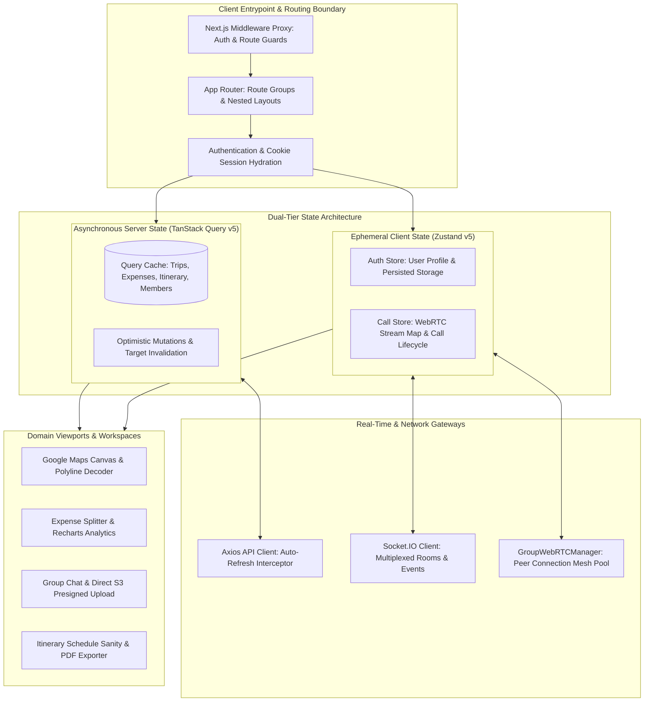
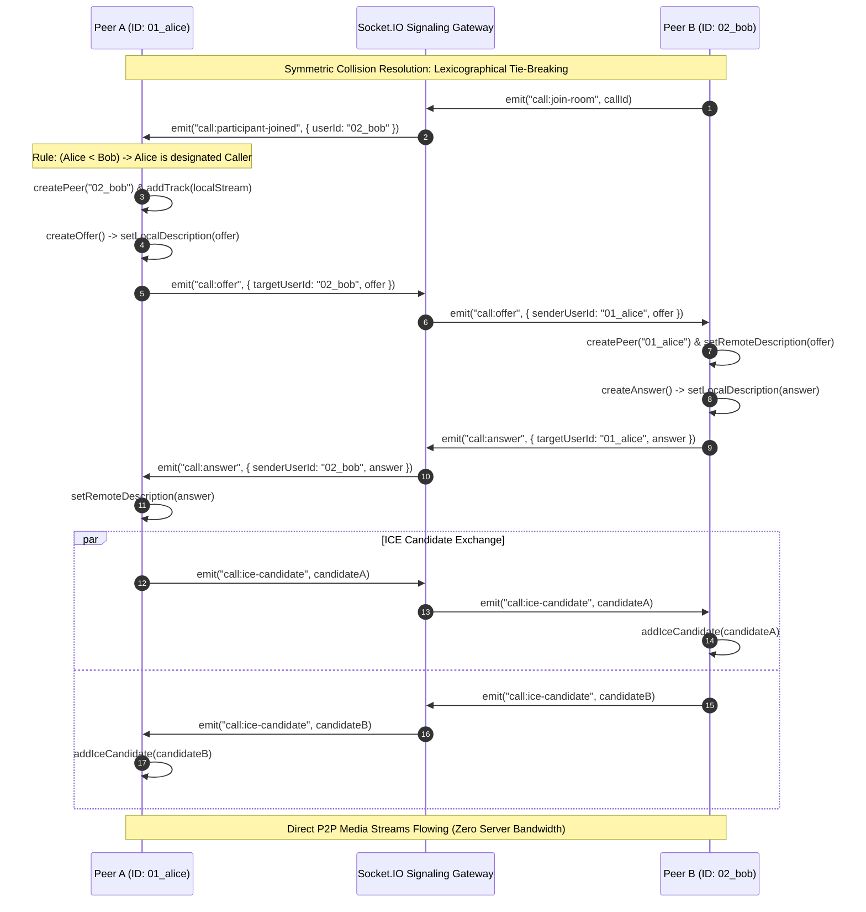
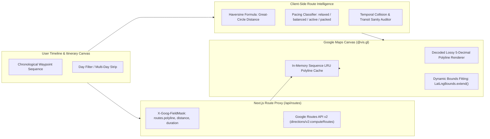
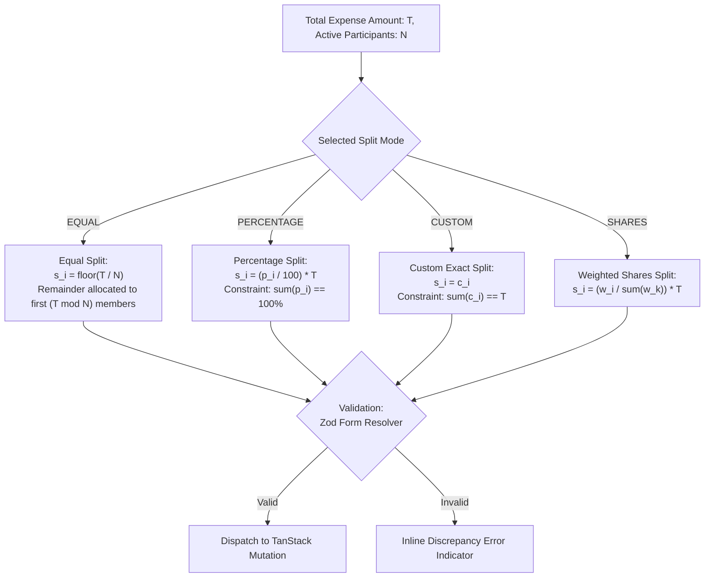
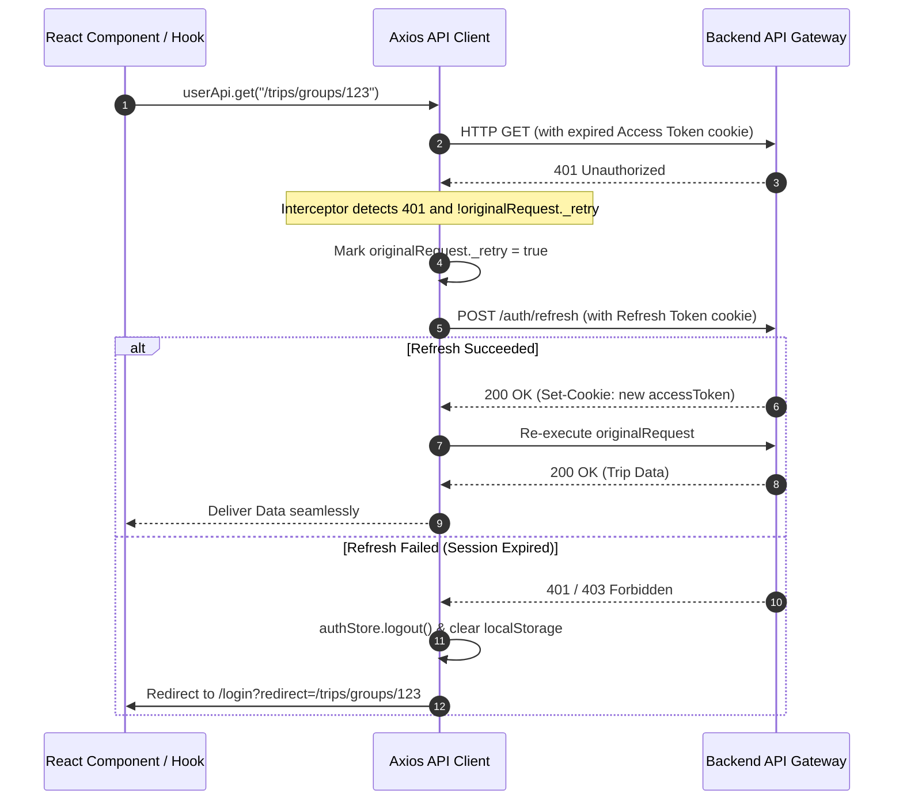

# Kafla Frontend Application (`kafla-client`)

> High-performance, real-time collaborative group expedition client. Engineered with Next.js 16 (App Router), React 19, TypeScript 5, Tailwind CSS v4, TanStack Query v5, Zustand v5, full-mesh WebRTC audio/video conferencing, and the Google Maps Platform modern Routes API v2.

[](https://nextjs.org/)
[](https://react.dev/)
[](https://www.typescriptlang.org/)
[](https://tailwindcss.com/)
[](https://tanstack.com/query/latest)
[](https://zustand-demo.pmnd.rs/)
[](https://webrtc.org/)
[](https://developers.google.com/maps)

---

## 1. System Architecture & Rendering Strategy

The frontend architecture is structured around a **Feature-Sliced Design (FSD)** paradigm running on **Next.js 16 App Router**. The client isolates server synchronization, ephemeral application state, real-time WebRTC media streams, and geographic render pipelines into distinct, decoupled boundaries.



### Dual-Tier State Engine

To prevent state synchronization anomalies and unnecessary component re-renders, client-side data is partitioned into two specialized engines:

1. **Asynchronous Server State (`@tanstack/react-query` v5)**:
   - Manages all remote RESTful resources (Trip Groups, Itineraries, Expenses, Balances, Checklists).
   - Configured with `staleTime: 60_000` (60 seconds) to prevent over-fetching on rapid tab transitions while disabling aggressive `refetchOnWindowFocus` to conserve network bandwidth.
   - Mutations execute deterministic query invalidation (`queryClient.invalidateQueries({ queryKey: [...] })`), triggering targeted subtree cache updates without global page reloads.

2. **Ephemeral & Persisted Client State (`zustand` v5)**:
   - `auth.store.ts`: Persisted in local storage via `zustand/middleware/persist` (`auth-storage`), tracking authenticated user profiles, session readiness, and onboarding state.
   - `call.store.ts`: In-memory reactive state managing multi-party WebRTC call lifecycles (`IDLE`, `OUTGOING`, `INCOMING`, `CONNECTING`, `ACTIVE`, `ENDING`), active `MediaStream` references, mute flags, and participant rosters.

---

## 2. Core Engineering Deep Dives

### 2.1. WebRTC Multi-Peer Mesh Conferencing Engine

Group calls utilize a decentralized **full-mesh WebRTC topology** (`GroupWebRTCManager.ts` & `useGroupWebRTC.ts`). Each client maintains direct, bidirectional peer-to-peer connections (`RTCPeerConnection`) with every other participant in the trip group room, coordinated through Socket.IO signaling.



#### Deterministic Glare Avoidance (Polite Peer Pattern)
In a decentralized full-mesh topology, concurrent connection attempts between two peers entering the room simultaneously cause offer collisions (WebRTC glare, throwing `InvalidStateError`). Kafla resolves this without an external coordinator by enforcing a **deterministic lexicographical tie-breaker**:

$$\text{Initiator}(u_A, u_B) = \begin{cases} u_A & \text{if } u_A < u_B \\ u_B & \text{if } u_B < u_A \end{cases}$$

```typescript
// Client/src/webRtc/GroupWebRTCManager.ts
if (this.currentUserId > remoteUserId) {
  // Callee: Passively wait for remote peer's offer to avoid collision
  return;
}
// Caller: Safely initiate offer negotiation
await this.createOffer(remoteUserId);
```

#### Resource Lifecycle & Garbage Collection
When a user disconnects or toggles media:
- Individual peer connections are isolated: `peer.close()` and `this.peers.delete(remoteUserId)`.
- Local media stream tracks are explicitly stopped (`track.stop()`) on unmount to release hardware camera and microphone drivers immediately.

---

### 2.2. Geographic Route Intelligence & Modern Routes API v2 Engine

The itinerary workspace contains a geographic routing and schedule optimization engine (`RouteMapCanvas.tsx`, `MapContent.tsx`, and `routeIntelligence.ts`).



#### 1. Secure Server-Side Route Reverse Proxy
Direct client-side calls to Google Maps expose private billing keys in browser network inspectors. Kafla proxies transit requests via Next.js API Routes (`Client/src/app/api/routes/route.ts`), utilizing strict Google Field Masking to minimize payload serialization:

$$\text{FieldMask} = \text{"routes.polyline.encodedPolyline,routes.distanceMeters,routes.duration"}$$

#### 2. Great-Circle Distance Calculation
For offline calculations, transit estimates, and route bounds verification, the client executes the **Haversine Formula** over consecutive spherical coordinates:

$$a = \sin^2\left(\frac{\Delta \phi}{2}\right) + \cos(\phi_1)\cos(\phi_2)\sin^2\left(\frac{\Delta \lambda}{2}\right)$$

$$c = 2 \cdot \text{atan2}\left(\sqrt{a}, \sqrt{1-a}\right)$$

$$d = R \cdot c \quad \text{where } R = 6371\text{ km}$$

#### 3. Temporal Sanity & Pacing Classification
`routeIntelligence.ts` inspects activity transition windows $(\Delta t = t_{\text{start}}^{(i+1)} - t_{\text{end}}^{(i)})$ against estimated transit durations $(\tau_{\text{commute}})$, classifying each day's pacing:

$$\text{Condition} = \begin{cases} \text{Overlap} & \text{if } \Delta t < 0 \\ \text{Tight Transit} & \text{if } 0 \le \Delta t < \tau_{\text{commute}} \\ \text{Feasible} & \text{if } \Delta t \ge \tau_{\text{commute}} \end{cases}$$

The total itinerary density maps to four operational pacing states: `relaxed`, `balanced`, `active`, and `packed`.

---

### 2.3. Mathematical Expense Split Engine & Debt Settlement

The expense module (`ExpenseSplitSection.tsx`, `BalancesPage.tsx`, `ReportPage.tsx`) implements live mathematical distributions across four settlement strategies before payload transmission:



#### Multi-Payer Split Formulations

| Strategy | Mathematical Formulation | Invariant Constraint |
| :--- | :--- | :--- |
| **Equal** | $s_i = \frac{T}{N}$ | $\sum_{i=1}^N s_i = T$ (handles sub-cent/paisa integer rounding) |
| **Percentage** | $s_i = T \times \left(\frac{p_i}{100}\right)$ | $\sum_{i=1}^N p_i = 100\%$ |
| **Custom (Exact)** | $s_i = c_i$ | $\sum_{i=1}^N c_i = T$ |
| **Shares (Ratio)** | $s_i = T \times \left(\frac{w_i}{\sum_{k=1}^N w_k}\right)$ | $w_i \in \mathbb{N}_{\ge 1}$ |

#### Dynamic Cash Flow Simplification Toggle
The `BalancesPage.tsx` interface provides a live switch between raw pairwise bilateral liabilities (`ORIGINAL`) and the backend's minimized net settlement transactions (`SIMPLIFIED`). Users can settle individual balances via `SettleUpModal.tsx`, which triggers optimistic balance adjustments across both views.

---

### 2.4. Autonomous Itinerary Synthesis & Client-Side Vector PDF Engine

```mermaid
flowchart LR
    subgraph Itinerary_Synthesis["AI Generation Modal Flow"]
        REQ[Trip Parameters: Dates, Pace, Style, Budget]
        STREAM[Step-by-Step Generation Progress Canvas]
        PREVIEW[Ghost Timeline Preview & Verification]
        COMMIT[Persist to Server Database]
    end

    subgraph PDF_Engine["Client-Side Vector PDF Engine (pdfExportEngine.ts)"]
        BUILD["Construct Print-Optimized DOM Tree"]
        SVG["Embed Inline Vector SVGs (Weather, Clocks, Markers)"]
        QR["Encode Navigation Deep Links"]
        PRINT["Execute window.print() via Sandboxed IFrame"]
    end

    REQ --> STREAM
    STREAM --> PREVIEW
    PREVIEW --> COMMIT
    COMMIT --> BUILD
    BUILD --> SVG
    SVG --> QR
    QR --> PRINT
```



#### Zero-Dependency Client-Side Vector PDF Engine
Rather than relying on heavy server-side PDF renderers (e.g., Puppeteer) that introduce substantial latency and memory overhead, Kafla features a client-side vector compilation engine (`pdfExportEngine.ts`):
- Assembles an isolated, print-optimized DOM document within a sandboxed `iframe`.
- Embeds crisp, inline SVG geometry for weather forecast icons, timeline clock markers, and category stamps at native 300+ DPI print resolution.
- Formats day-by-day activity schedules with duration badges, notes, and Google Maps mobile deep links.
- Triggers native OS print drivers directly via `iframe.contentWindow.print()`, producing publication-quality travel guides with zero external binary bloat.

---

### 2.5. Resilient Network Layer & Silent Token Refresh

The Axios HTTP client (`Client/src/lib/api-client.ts`) enforces silent JWT token renewal through a response interceptor with infinite loop prevention:



---

## 3. Directory Layout & Feature Modularization

The codebase strictly adheres to a feature-sliced modular directory structure under `Client/src`:

```
Client/src/
├── app/                                 # Next.js 16 App Router routes
│   ├── (auth)/                          # Route group: login, signup
│   ├── (forgot-pass)/                   # Route group: password reset
│   ├── (onboarding)/                    # Route group: user preference onboarding
│   ├── (verify)/                        # Route group: OTP & email verification
│   ├── api/                             # Edge & Node route proxies
│   │   ├── places/                      # Google Places autocomplete & details proxy
│   │   └── routes/                      # Google Routes API v2 reverse proxy
│   ├── mcp-auth/                        # Model Context Protocol authorization route
│   ├── trips/                           # Protected trip management workspace
│   │   ├── groups/
│   │   │   ├── (dashboard)/[id]/        # Nested group workspace routes
│   │   │   │   ├── chat/page.tsx        # Real-time group messaging & media
│   │   │   │   ├── checklist/page.tsx   # Categorized collaborative task board
│   │   │   │   ├── expenses/            # Expense root, balances & visual reports
│   │   │   │   ├── itinerary/page.tsx   # Interactive route map & schedule canvas
│   │   │   │   ├── members/page.tsx     # Member management & invite link generator
│   │   │   │   └── overview/page.tsx    # Expedition summary & countdown dashboard
│   │   │   └── page.tsx                 # User trips directory
│   │   └── layout.tsx                   # Trip route auth validation boundary
│   ├── globals.css                      # Tailwind v4 theme configuration
│   ├── layout.tsx                       # Root HTML shell & metadata
│   ├── page.tsx                         # High-conversion expedition landing page
│   └── provider.tsx                     # TanStack Query & Google OAuth provider shell
│
├── components/                          # Cross-feature design system components
│   ├── providers/                       # Global authentication context wrapper
│   ├── ui/                              # Atoms: Buttons, inputs, modals, tooltips
│   ├── Avatar.tsx                       # Resilient initials / image avatar component
│   └── TripHQTopBar.tsx                 # Workspace top navigation banner
│
├── features/                            # Domain-driven feature slices
│   ├── landing/                         # Landing page command center & previews
│   └── user/
│       ├── auth/                        # Login, signup, password reset forms
│       ├── onboarding/                  # Multi-step profile & travel persona setup
│       └── trips/                       # Core collaborative workspace modules
│           ├── components/              # Shared trip cards, modals, headers
│           └── features/
│               ├── call/                # WebRTC video/audio components & controller
│               ├── chat/                # Real-time chat stream & attachment pipeline
│               ├── checklist/           # Task items, filters & assignee selector
│               ├── expense/             # Split forms, settlement modal, Recharts
│               ├── itenary/             # RouteMapCanvas, pacing engine, PDF engine
│               └── members/             # Roster management & invitation controls
│
├── hooks/                               # Generic utility hooks (debounce, timers)
├── lib/                                 # Axios client configuration & interceptors
├── socket/                              # Decoupled WebSocket emitters & listeners
│   ├── call/call.socket.ts              # WebRTC signaling event subscriptions
│   ├── chat/chat.socket.ts              # Real-time chat event subscriptions
│   └── socket.ts                        # Singleton Socket.IO client manager
│
├── store/                               # Zustand global client stores
│   ├── auth.store.ts                    # Persisted user credentials & auth flags
│   └── call.store.ts                    # WebRTC active call state & remote streams
│
├── types/                               # System-wide TypeScript type declarations
├── utils/                               # Formatters, string manipulation, constants
├── webRtc/                              # GroupWebRTCManager connection pool class
└── proxy.ts                             # Next.js edge route protection proxy
```

---

## 4. Performance, Core Web Vitals & Security

### Performance Engineering
- **React 19 Concurrent Rendering**: Offloads complex UI calculations (e.g., dynamic expense share calculations and itinerary re-indexing) without blocking the browser main thread.
- **Turbopack Compiler**: Sub-second Hot Module Replacement (HMR) and optimized dead-code elimination during production bundling.
- **Zero-Runtime CSS**: Tailwind CSS v4 compiles utility classes into a single optimized stylesheet via `@tailwindcss/postcss`, avoiding JavaScript runtime style recalculation.
- **In-Memory Geo Caching**: `MapContent.tsx` uses an in-memory LRU route cache (`roadPathCache`) keyed by coordinate sequences to prevent redundant Google Routes API network roundtrips when switching between day views.

### Security Posture
- **Direct-to-S3 Presigned Uploads**: User image attachments and trip covers stream directly from the browser to AWS S3 using presigned URLs obtained from the backend. Sensitive media never touches the intermediary application server memory.
- **Edge Route Guards**: `proxy.ts` verifies session refresh tokens prior to route rendering. Unauthorized attempts to access `/trips/*` are intercepted at the edge and redirected to `/login` with deep-link preservation (`?redirect=...`).
- **XSS & Injection Protection**: User input in chat and rich text is validated with Zod schemas and rendered through React's native string escape pipelines.

---

## 5.Setup Guide

### 5.1. Installation & Development

```bash
# Navigate to the Client directory
cd Client

# Install production and development dependencies
npm install

# Start the local development server on port 3001
npm run dev

# Run TypeScript static type verification
npx tsc --noEmit

# Compile production build
npm run build

# Start production server
npm run start
```

### 5.2. Available Scripts

| Script | Purpose |
| :--- | :--- |
| `npm run dev` | Boots the Next.js development server with Turbopack on port `3001` |
| `npm run build` | Compiles and optimizes the production application bundle |
| `npm run start` | Runs the compiled production server on port `3001` |
| `npm run lint` | Executes ESLint analysis across TypeScript and JSX sources |
