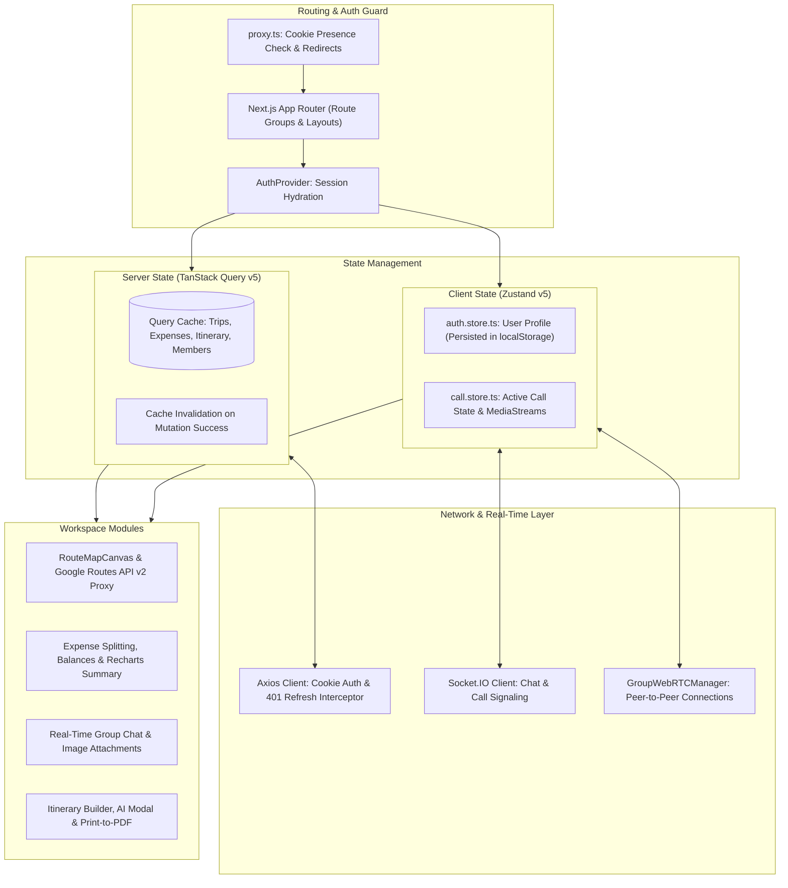
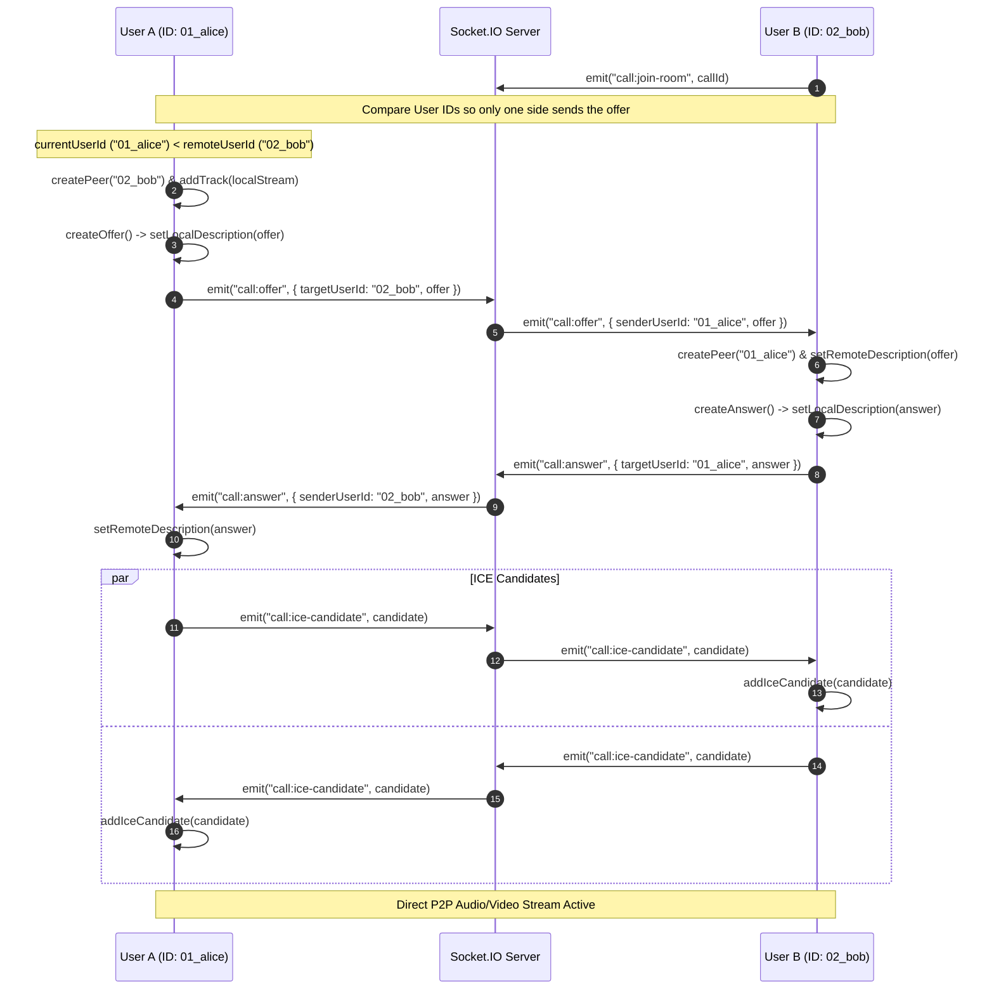
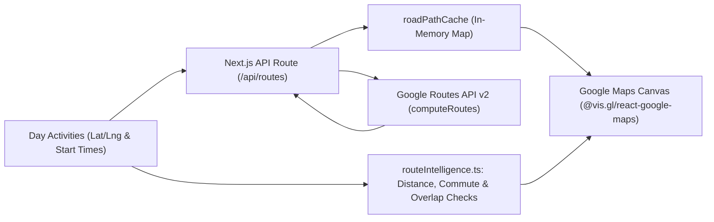
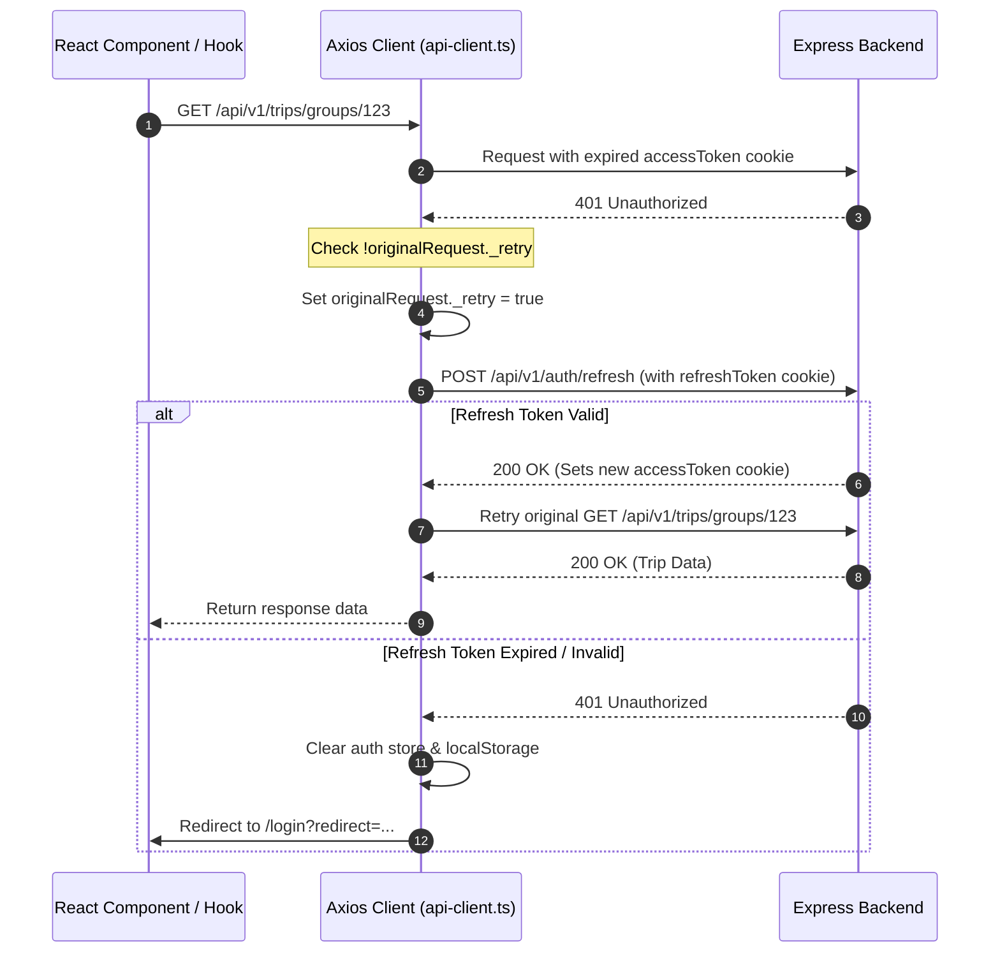

# Kafla Frontend (`kafla-client`)

Frontend web application for **Kafla**, a collaborative group trip planning workspace. Built with Next.js 16 (App Router), React 19, TypeScript, Tailwind CSS v4, TanStack Query v5, Zustand v5, Socket.IO, WebRTC, and Google Maps (`@vis.gl/react-google-maps`).

[](https://nextjs.org/)
[](https://react.dev/)
[](https://www.typescriptlang.org/)
[](https://tailwindcss.com/)
[](https://tanstack.com/query/latest)
[](https://zustand-demo.pmnd.rs/)

---

## 1. Architecture Overview

The client is organized by feature modules under `src/features` and uses the Next.js App Router (`src/app`) for routing and server-side API proxying.



### State Management Split

1. **Server Data (`@tanstack/react-query` v5)**:
   - Handles API fetching and caching for trips, itineraries, expenses, balances, and checklists.
   - Configured in `src/app/provider.tsx` with `staleTime: 60 * 1000` (1 minute) and `refetchOnWindowFocus: false` to avoid unnecessary refetches when switching tabs.
   - Mutations invalidate affected query keys in `onSuccess` (`queryClient.invalidateQueries`) so the UI stays in sync with the backend.

2. **Client State (`zustand` v5)**:
   - `auth.store.ts`: Persisted to `localStorage` (`auth-storage`), storing the logged-in user's profile and auth status.
   - `call.store.ts`: In-memory store tracking WebRTC call status (`IDLE`, `OUTGOING`, `INCOMING`, `CONNECTING`, `ACTIVE`, `ENDING`), local/remote `MediaStream` objects, and mic/camera mute states.

---

## 2. Key Features & Implementation Details

### 2.1. Group Audio/Video Calls (WebRTC + Socket.IO)

Group calls use a **peer-to-peer mesh setup** (`GroupWebRTCManager.ts` and `useGroupWebRTC.ts`), where each participant opens a direct `RTCPeerConnection` with every other participant in the call, using Socket.IO to exchange SDP offers, answers, and ICE candidates.



- **Preventing Simultaneous Offers**: When two users connect to each other at the same time, both trying to call `createOffer()` causes a signaling state conflict (`signalingState !== "stable"`). `GroupWebRTCManager.ts` avoids this by comparing user IDs before creating an offer:
  ```typescript
  // Client/src/webRtc/GroupWebRTCManager.ts
  if (this.currentUserId > userId) {
    console.log(`[GroupWebRTC] Waiting for ${userId} to offer`);
    continue;
  }
  await this.createOffer(userId);
  ```
- **Stream Cleanup**: When a participant leaves or ends a call, `peer.close()` is called for each connection and `track.stop()` is called on local media tracks to release the camera and microphone.

---

### 2.2. Interactive Route Maps & Schedule Checks

The itinerary view (`RouteMapCanvas.tsx`, `MapContent.tsx`, and `routeIntelligence.ts`) renders daily activity stops and driving routes on Google Maps.



1. **Next.js API Proxy for Google Routes (`/api/routes`)**:
   - Requests to `https://routes.googleapis.com/directions/v2:computeRoutes` are proxied through `src/app/api/routes/route.ts`.
   - Uses `X-Goog-FieldMask: routes.polyline.encodedPolyline,routes.distanceMeters,routes.duration` so Google only returns the encoded route geometry, distance, and travel time.
2. **In-Memory Route Cache (`roadPathCache`)**:
   - `mapTypes.ts` keeps a `Map<string, Array<{ lat: number; lng: number }>>` keyed by the day's coordinate sequence so switching back and forth between day tabs reuses the decoded road path without calling `/api/routes` again.
3. **Client-Side Distance & Schedule Warnings (`routeIntelligence.ts`)**:
   - Uses the Haversine formula to calculate straight-line distances between consecutive stops and estimate travel time.
   - Compares the time gap between activities against the estimated commute time to flag scheduling issues (`overlap` when activities overlap in time, or `tight` when the gap is shorter than the commute) and labels the day's pace as `relaxed`, `balanced`, `active`, or `packed`.

---

### 2.3. Expense Splitting & Balance Views

The expense feature (`AddExpenceModal.tsx`, `ExpenseSplitSection.tsx`, `BalancesPage.tsx`, `ReportPage.tsx`) supports logging shared trip costs and tracking settlements:

- **Four Split Modes**:
  - `EQUAL`: Divides the expense evenly across participants (with the backend adjusting any rounding remainder on the last participant).
  - `PERCENTAGE`: Splits by percentage per member (validated to sum to 100%).
  - `CUSTOM`: Splits by exact currency amounts per member (validated to match the total amount).
  - `SHARES`: Splits proportionally based on relative share weights (e.g., `2 shares` vs `1 share`).
- **Original vs. Simplified Balances**:
  - `BalancesPage.tsx` lets users switch between `ORIGINAL` (every direct debt between pairs of members) and `SIMPLIFIED` (minimized net payments computed by the backend).
  - Recording a payment in `SettleUpModal.tsx` invalidates the balances, summary, and report queries so all expense tabs update immediately.

---

### 2.4. Printable Itinerary Export (`pdfExportEngine.ts`)

Instead of bundling a large PDF library, `pdfExportEngine.ts` generates a clean A4 printable view using the browser's native print engine:
- Builds an HTML document with `@page` print CSS rules (`page-break-inside: avoid`), activity schedules, notes, weather forecasts, and inline SVG icons.
- Writes the HTML into a hidden `<iframe>` and calls `iframe.contentWindow.print()`, allowing users to save a clean PDF directly from their browser.

---

### 2.5. Axios Interceptor & Automatic Token Refresh

The HTTP client (`src/lib/api-client.ts`) sends requests with `withCredentials: true` so `HttpOnly` auth cookies are included automatically, and handles expired access tokens via a response interceptor:



---

## 3. Project Structure

```
Client/src/
├── app/                                 # Next.js App Router pages & API routes
│   ├── (auth)/                          # Login and signup pages
│   ├── (forgot-pass)/                   # Forgot password & reset flow
│   ├── (onboarding)/                    # User onboarding flow
│   ├── (verify)/                        # Email OTP verification page
│   ├── api/                             # Server-side route handlers
│   │   ├── places/                      # Google Places autocomplete & details proxy
│   │   └── routes/                      # Google Routes API v2 proxy
│   ├── mcp-auth/                        # Browser authorization page for Kafla MCP server
│   ├── trips/                           # Trip workspace pages
│   │   └── groups/
│   │       ├── (dashboard)/[id]/        # Group tabs: overview, itinerary, expenses, chat, checklist, members
│   │       ├── join/[inviteCode]/       # Invite link join page
│   │       └── page.tsx                 # My trips list
│   ├── provider.tsx                     # TanStack Query & Google OAuth providers
│   └── layout.tsx                       # Root layout
│
├── components/                          # Shared UI components (Avatar, TopBar, modals, inputs)
├── features/                            # Feature modules
│   ├── landing/                         # Landing page sections
│   └── user/
│       ├── auth/                        # Auth forms, hooks, services, Zod schemas
│       ├── onboarding/                  # Onboarding components & services
│       └── trips/                       # Group workspace feature modules
│           ├── components/              # Shared trip cards, headers, modals
│           └── features/
│               ├── call/                # Audio/video call UI & hooks
│               ├── chat/                # Group chat UI, message list & image upload
│               ├── checklist/           # Packing/task checklist board
│               ├── expense/             # Expense forms, split preview, balances & Recharts
│               ├── itenary/             # Itinerary timeline, AI modal, map canvas & PDF print
│               └── members/             # Member list, roles & invite modal
│
├── hooks/                               # Shared custom hooks (debounce, geolocation, etc.)
├── lib/                                 # Axios instance & 401 refresh interceptor
├── socket/                              # Socket.IO client setup & event helpers (chat, call)
├── store/                               # Zustand stores (auth.store.ts, call.store.ts)
├── types/                               # Shared TypeScript interfaces
├── utils/                               # Formatting & helper utilities
├── webRtc/                              # GroupWebRTCManager class
└── proxy.ts                             # Route redirect guard checking refreshToken cookie
```

---

## 4. Getting Started

### Installation & Local Development

```bash
# Navigate to the Client folder
cd Client

# Install dependencies
npm install

# Run the development server on port 3001
npm run dev

# Type-check the project
npx tsc --noEmit

# Build for production
npm run build

# Start the production server
npm run start
```

### Scripts

| Script | Description |
| :--- | :--- |
| `npm run dev` | Starts the Next.js development server on port `3001` |
| `npm run build` | Builds the production application |
| `npm run start` | Starts the production server on port `3001` |
| `npm run lint` | Runs ESLint across the project |
